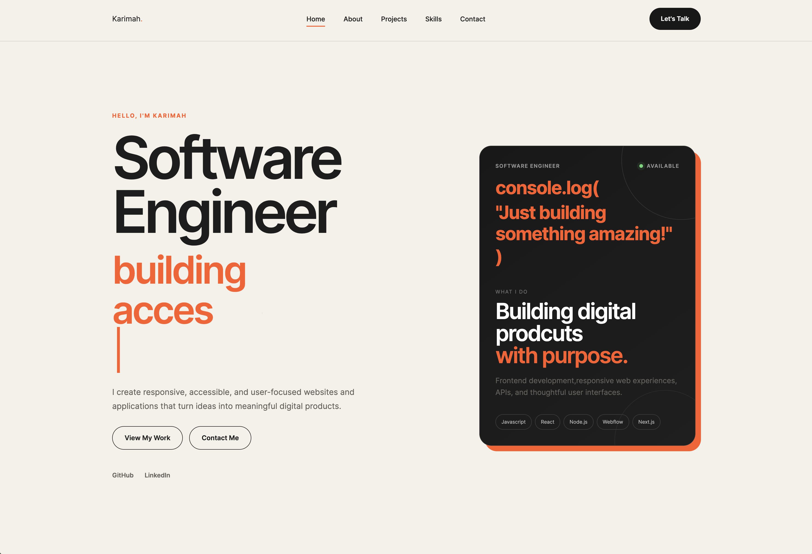

# Kareemah Bahaadur | Software Engineer Portfolio

My personal portfolio website, built from scratch with plain HTML, CSS, and JavaScript. It introduces who I am, shows my featured projects, lists the tools I use, and gives people a way to get in touch.

🔗 **Live Site:** [portfolio-kb122215.vercel.app](https://portfolio-kb122215.vercel.app/)



## 📄 Pages

| Page                           | What's on it                                                                                                           |
| ------------------------------ | ---------------------------------------------------------------------------------------------------------------------- |
| **Home** (`index.html`)        | Hero with a typing effect, skills ticker, about preview, featured projects, skills preview, and a call to connect      |
| **About** (`about.html`)       | My story, the values I build with, and an experience timeline                                                          |
| **Projects** (`projects.html`) | Four small business websites, each with a preview image, description, tech tags, and links to the live site and GitHub |
| **Skills** (`skills.html`)     | My toolbox in five groups: Frontend, Backend & Data, Developer Tools, Design & Web, and How I Work                     |
| **Contact** (`contact.html`)   | Email, social links, and a contact form                                                                                |

---

## ✨ Features

- **Typing effect** in the hero that cycles through phrases like "responsive web applications."
- **Active nav link**: the current page is highlighted and marked with `aria-current="page"`
- **Scroll reveal**: sections fade in as you scroll, using `IntersectionObserver`
- **3D tilt on project cards** that follows the mouse (desktop only)
- **Back-to-top button** that appears after scrolling, with smooth scrolling and keyboard support
- **Auto-updating copyright year** in the footer
- **Responsive layout** for desktop, tablet, and mobile
- **Reduced motion support**: animations are toned down for visitors who turn on reduced motion in their system settings

---

## 🗂️ Featured Projects

| Project           | What it is                                                                             | Links                                                                                              |
| ----------------- | -------------------------------------------------------------------------------------- | -------------------------------------------------------------------------------------------------- |
| **LineUP**        | Walk-in waitlist site for barbershops, salons, and other local service shops           | [Live](https://lineupsmb.netlify.app/) · [Code](https://github.com/kb122215/lineup_SMB)            |
| **Maine Lobster** | Website for a waterfront lobster shack: food, menu, hours, and location                | [Live](https://smbusinessmn.netlify.app/) · [Code](https://github.com/kb122215/Maine-Lobester_SMB) |
| **Philly Water**  | Website for a Philadelphia water ice stand: flavors, sizes, prices, and seasonal hours | [Live](https://phillywatersmb.netlify.app/) · [Code](https://github.com/kb122215/phillywater)      |
| **Boston Barber** | Small business website for a barbershop                                                | [Live](https://bostonbarbersmb.netlify.app/) · [Code](https://github.com/kb122215/boston-barber)   |

---

## 🛠️ Tech Stack

- HTML5 (semantic markup)
- CSS3 (custom properties, Flexbox, Grid, media queries, animations)
- JavaScript (`IntersectionObserver`, DOM manipulation, event listeners)
  No frameworks, dependencies, or build tools.

---

## 📁 Project Structure

```
Portfolio/
├── index.html          # Home page
├── about.html          # About page
├── projects.html       # Projects page
├── skills.html         # Skills page
├── contact.html        # Contact page
├── css/
│   └── main.css        # All styles, including responsive and reduced-motion rules
├── js/
│   └── main.js         # Nav highlight, typing effect, scroll reveal, card tilt, back-to-top
└── *.png               # Project previews and profile images
```

---

## 🚀 Run It Locally

```bash
git clone https://github.com/kareemahb/Portfolio.git
cd Portfolio
```

Open `index.html` in your browser, or use the **Live Server** extension in VS Code.

---

## 💡 What I Learned

- Planning and building a multi-page site with a shared layout, navigation, and footer
- Writing one stylesheet that keeps every page consistent
- Using `IntersectionObserver` for scroll animations instead of listening to every scroll event
- Building small interactive touches (typing effect, card tilt, back-to-top) with plain JavaScript
- Thinking about accessibility: `aria-current`, `aria-label`, keyboard support, and reduced motion

---

## 📬 Contact

- **Email:** [kareemahbahaadur78@gmail.com](mailto:kareemahbahaadur78@gmail.com)
- **LinkedIn:** [linkedin.com/in/kareemahbahaadur](https://www.linkedin.com/in/kareemahbahaadur/)
- **GitHub:** [github.com/kb122215](https://github.com/kb122215) · [github.com/kareemahb](https://github.com/kareemahb)
